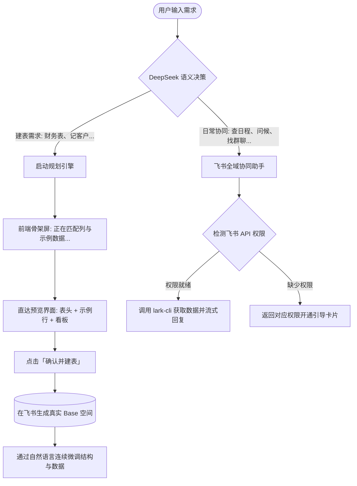

# 飞书智能工作台 (Lark Workbench for DeepSeek Harness)

[English](README_EN.md) | [简体中文](README.md)

> **一句话，建一张表；一句话，调度飞书全域协同。**  
> 专为 [DeepSeek Harness](https://github.com/deepseek-ai) 生态打造的大模型原生（LLM-Native）飞书全域协同与多维表格智能工作台插件。

---

## 目录
- [1. 这是什么？](#1-这是什么)
- [2. 可以用来干什么？](#2-可以用来干什么)
- [3. 为什么需要这种 UI 级工作台？](#3-为什么需要这种-ui-级工作台)
- [4. 飞书全功能清单（全景列表）](#4-飞书全功能清单全景列表)
- [5. 核心架构与交互流转](#5-核心架构与交互流转)
- [6. 快速开始与安装部署](#6-快速开始与安装部署)
  - [前置依赖](#前置依赖)
  - [安装方式](#安装方式)
  - [首次连接三步向导 (ConnectGate)](#首次连接三步向导-connectgate)
- [7. 常见问题 (FAQ)](#7-常见问题-faq)
- [8. 开源协议](#8-开源协议)

---

## 1. 这是什么？

**飞书智能工作台 (`dsh-lark-studio`)** 是一款深度集成在 DeepSeek Harness 桌面客户端中的 Agent 级桌面扩展插件。

它以 **DeepSeek 大语言模型底座**为智力引擎，底层无缝桥接飞书官方命令行工具 **`lark-cli` (`@larksuite/cli`)** 与飞书开放平台 OpenAPI。通过自然语言交互，抹平技术名词、表单配置与繁琐 API 调用的门槛，让用户只需“说大白话”，即可完成从**多维表格（Bitable Base）架构设计、字段搭建、数据维护**，到**日程排期、待办任务、即时通讯、邮件检索与通讯录查询**的飞书全域业务闭环。

---

## 2. 可以用来干什么？

### 2.1 说一句话，秒级生成专业多维表格
* **大白话直出专业表**：输入 *“我想记一下客户”*、*“做一个部门团建报销表”*、*“研发缺陷与需求跟踪”*，大模型自动推导业务逻辑，瞬间生成含 5~10 个规范业务字段、单选状态标签、看板分组、企业级真实仿真示例数据的完整 Base 蓝图。
* **业务规范化命名**：告别随手乱取的列名，AI 自动将“多少钱”规范为“预计金额”，“谈到哪一步”规范为“销售阶段”，“谁负责”匹配为人员字段。
* **一键落盘飞书真表**：在界面直接点击「确认并建表」，后台自动在飞书个人空间创建对应的多维表格，并生成可直接分享给团队的公开链接。

### 2.2 在线连续对话微调（Chat-to-Table Ops）
* **表结构动态演进**：无需去飞书后台逐个点开设置，在工作台内直接说话：
  * *“再加一列报销状态，支持未提交、审批中、已打款”*
  * *“把优先级这一列的低、中、高改成 P0、P1、P2”*
  * *“删掉上次沟通时间这一列”*
  * *“新增一个按优先级分组的看板视图”*
* **智能数据运维与批量处理**：
  * *“帮我新增一条客户记录，公司叫字节跳动，联系人张三，预算 50 万”*
  * *“把所有进行中的任务截止日期推迟到下周五”*
  * *“帮我清空所有已作废的账单”*

### 2.3 飞书全域协同全能助手（Universal Lark Agent）
不仅是多维表格工具，更是连接飞书日常办公的全局助手：
* **日程协同**：*“查一下我今天有什么日程”*、*“明天下午有空闲时间吗”*，自动提取日程事件与时间地点。
* **待办管理**：*“列出我所有未完成的待办任务”*、*“标记‘编写方案’为已完成”*。
* **即时通讯**：*“帮我找一下最近活跃的项目群聊”*、*“给研发群发一条上线进度通知”*。
* **邮件速览**：*“查看我的未读邮件并做个摘要”*。
* **通讯录与组织**：*“搜一下市场部李四的工号、邮箱和职位”*。

---

## 3. 为什么需要这种 UI 级工作台？

单纯的终端命令行（CLI）或纯文字聊天机器人在处理“结构化业务”时存在天然的局限，本插件打造专用 UI 工作台的核心价值在于：

| 维度 | 传统纯文本对话 / 终端 CLI | 飞书智能工作台 (UI) | 工作台的意义与价值 |
| :--- | :--- | :--- | :--- |
| **感知体验** | 黑盒输出，只给出一段 JSON 或一句话“已创建”，用户不知道实际字段是否合规 | **动态骨架屏加载 $\rightarrow$ 结构化卡片直观预览** | **所见即所得 (WYSIWYG)**：在落盘前用户能清晰核对每一列的字段类型、选项标签、仿真样本，避免误建垃圾表。 |
| **接入门槛** | 需手动安装依赖、手动创建 App、在终端敲命令获取 OAuth Code、扫码授权，流程极易中断 | **内置三步向导 (ConnectGate)** | **零门槛开箱即用**：自动嗅探 `lark-cli` 环境，一键复制安装命令，图形化引导应用配置与扫码登录。 |
| **双屏作业** | 聊天窗口与真实飞书界面分离，用户需反复在浏览器与终端之间切换排查 | **分屏双工模式 (Dual-pane Mode)** | **真表联动无缝**：左侧为 AI 微调控制台，右侧支持一键内嵌飞书真实多维表格 Webview，边聊边改，真表实时同步。 |
| **思维透明度**| 交互生硬，等待过程黑屏或干等卡顿，无法得知模型意图 | **深度思考实时流 (Thinking Stream)** | **透明可信赖的 Agent**：DeepSeek 的思考链路实时展示，让用户清晰看到大模型背后的业务拆解、字段类型推导逻辑。 |
| **安全性** | 误操作直接破坏真实数据，无法逆转 | **破坏性操作主动拦截拦截机制** | **安全有保障**：对删列、清空表、删除大量记录等高危操作主动弹出二次确认卡片，杜绝数据误删事故。 |

---

## 4. 飞书全功能清单（全景列表）

本插件全面覆盖飞书开放平台多维表格及协同办公全域能力，具体支持清单如下：

### 4.1 多维表格（Bitable Base）架构与元数据
- [x] **智能蓝图设计**：根据一句自然语言自动输出整套标准 Schema，含数据表、列类型、看板分组与示例行。
- [x] **多表管理**：
  - 新增数据表（`add_table`）
  - 重命名数据表（`rename_table`）
  - 获取库元数据与表列表（`readSchema`）
- [x] **字段（列）生命周期管理**：
  - **文本类**：普通文本、单行/多行、超链接 (URL)、电话 (Phone)、电子邮箱 (Email)、条形码 (Barcode)
  - **数值类**：普通整数/浮点数、格式化货币（CNY/USD 等精度设置）、百分比、进度条（带颜色展示）
  - **选项类**：单选下拉（Select）、多选标签（Multiple Select）
  - **动态选项池**：增量追加选项（`add_options`）、安全剔除选项（`remove_options`）
  - **时间日期**：自定义格式日期时间（`yyyy-MM-dd` / `yyyy-MM-dd HH:mm` 等）
  - **协作人员**：飞书企业组织人员字段（User）
  - **逻辑控制**：复选框字段（Checkbox）
  - **高级与计算列**：自增编号（Auto Number）、公式计算列（Formula）、双向关联引用（Link / Lookup）
  - **字段修改与删除**：列重命名（`rename_field`）、安全删除列（`delete_field`）

### 4.2 多维表格视图与展示维度
- [x] **经典网格视图（Grid View）**：数据总览与录入标准表格。
- [x] **看板泳道视图（Kanban View）**：基于特定单选字段（如任务状态、推进阶段）自动分栏展示。
- [x] **相册画册视图（Gallery View）**：富媒体、商品图与资产卡片展示。
- [x] **日历排期视图（Calendar View）**：按起止日期字段映射日历排程。
- [x] **甘特进度视图（Gantt View）**：项目工期与前后置任务排期。
- [x] **视图管理**：新建视图（`add_view`）、重命名视图（`rename_view`）、删除视图（`delete_view`）。
- [x] **字段显隐控制（View Masking）**：指定特定视图下显示或隐藏特定列（`set_view_visible_fields`）。

### 4.3 记录级数据增删改查（Records Operations）
- [x] **智能批量插入（Add Records）**：自动校验并格式化文本、单选、数值类型，批量追加行记录。
- [x] **条件精准与批量修改（Update Records）**：支持基于复合条件（如 `状态 === "已完成"`）批量或单条更新记录内容。
- [x] **安全批量与单条删除（Delete Records）**：支持条件过滤删除与指定 Record ID 物理删除。
- [x] **样本数据快速探查（Peek Sampling）**：无需打开庞大表格，快速探查前 20 条实时数据结构。

### 4.4 扩展能力与企业高级权限
- [x] **高级权限控制（Advanced Permission）**：一键开启或关闭多维表格的高级权限隔离开关。
- [x] **自定义角色权限体系**：
  - 创建角色（`create_role`，定义表级与字段级编辑/只读权限）
  - 更新角色权限（`update_role`）
  - 删除角色（`delete_role`）
- [x] **字段 AI 扩展插件（Field AI Extension）**：为指定字段绑定飞书内置 AI 能力，支持自然语言触发批量运算。
- [x] **统计分析仪表盘（Dashboard）**：自动为表格配置多维度图表与统计看板。
- [x] **收集问卷表单（Form）**：自动将表格转为外发数据收集问卷。

### 4.5 飞书全域办公协同（Universal Collaboration）
### 4.5 飞书全域办公协同（Universal Collaboration CRUD 矩阵）

对照飞书官方 `lark-cli` 体系，工作台不仅支持多维表格的深度运维，还对飞书协同生态各域提供了完整的**增（Create）、删（Delete）、改（Update）、查（Retrieve/Query）**全生命周期能力覆盖：

#### 📅 日历与会议（Calendar）
* **增 (Create)**：创建日程与预约会议（`calendar +create`，支持指定主题、起止时间与参会人）、加入日程（`+join-event`）。
* **删 (Delete)**：删除或取消日程会议（`calendar +delete`，支持周期日程与例外项）。
* **改 (Update)**：更新日程时间地点与参会人（`calendar +update`）、回复会议邀请（`+rsvp` 接受/拒绝/待定）、转让日程组织者权限（`+transfer`）。
* **查 (Query)**：今日/特定日期议程速览（`calendar +agenda`）、日程详情（`+get`）、关键词搜索日程（`+search-event`）、跨用户忙闲诊断（`+freebusy`）、智能会议室推荐（`+room-find`）、参会人签到状态（`+list-attendees`）、会议详情与纪要链接（`+meeting`）。

#### 📋 任务与待办（Task）
* **增 (Create)**：新建待办任务（`task +create`）、新建任务清单（`+tasklist-create`）、拆分子任务（`subtasks create`）、添加任务评论（`+comment`）、上传附件（`+upload-attachment`）。
* **删 (Delete)**：删除任务（`task tasks delete`）、删除任务清单（`tasklists delete`）、移除成员（`members remove`）。
* **改 (Update)**：一键标记完成（`task +complete`）、重新打开任务（`+reopen`）、指派/转交责任人（`+assign`）、修改截止日期与描述（`+update`）、设置关注人（`+followers`）、设置任务提醒（`+reminder`）。
* **查 (Query)**：我的待办清单（`task +get-my-tasks`）、与我相关的任务（`+get-related-tasks`）、关键词搜索任务（`+search`）、搜索任务清单（`+tasklist-search`）。

#### 💬 消息与即时通讯（IM）
* **增 (Create / Send)**：发送文本/Markdown/卡片消息（`im +messages-send`，支持单聊与群聊）、消息串联回复（`+messages-reply`）、新建群聊/话题群（`+chat-create`）、消息星标标记（`+flag-create`）、置顶消息（`pins create`）。
* **删 (Delete / Recall)**：撤回或删除已发消息（`im messages delete`）、取消星标（`+flag-cancel`）、取消置顶（`pins delete`）。
* **改 (Update)**：编辑已发送消息内容（`im +messages-edit`）、更新群名称与群公告描述（`+chat-update`）、修改群成员权限与禁言（`chat.moderation update`）。
* **查 (Query)**：群聊列表速览（`im +chat-list`）、关键词搜索群聊（`+chat-search`）、查看群成员列表（`+chat-members-list`）、拉取历史聊天记录（`+chat-messages-list`）、跨群检索消息（`+messages-search`）、查看消息已读人员清单（`+message-read-users`）、标记消息列表（`+flag-list`）。

#### ✉️ 飞书邮箱（Mail）
* **增 (Create / Compose)**：撰写并发送新邮件（`mail +send`）、新建邮件草稿（`+draft-create`）、创建收信过滤规则（`+rule-create`）、创建邮件模板（`+template-create`）。
* **删 (Delete / Trash)**：软删除邮件移至废纸篓（`mail +message-trash`）、删除会话主题（`+thread-trash`）、删除收信规则（`+rule-delete`）、废弃草稿（`user_mailbox.drafts delete`）。
* **改 (Update / Reply)**：回复与全部回复（`mail +reply` / `+reply-all`）、转发邮件（`+forward`）、编辑已有草稿（`+draft-edit`）、发送已有草稿（`+draft-send`）、标记已读/移动文件夹/打标签（`+message-modify`）、更新收信规则（`+rule-update`）、启停收信规则（`+rule-enable`/`disable`）。
* **查 (Query)**：收件箱速览（`mail +triage`）、读取邮件全文与附件（`+message` / `+messages`）、查看完整邮件往来会话（`+thread`）、文件夹列表（`user_mailbox.folders list`）、规则列表（`+rule-list`）、签名配置（`+signature`）。

#### 👤 通讯录与组织架构（Contact）
* **查 (Query)**：自然语言搜索同事（`contact +search-user`，按姓名、工号、部门反查）、获取个人详细档案与联系方式（`+get-user`）、搜索企业机器人与智能体应用（`+search-bot`）、批量查询用户基础资料（`user_profiles batch_query`）。
* **增删改 (Enterprise Ops)**：通过企业管理员凭据支持部门层级创建、成员资料更新与离职归档。

#### 🛡️ 审批与业务流（Approval）
* **增 (Initiate)**：快速发起请假、报销、用印等各类业务审批单实例（`approval instances create`）。
* **撤 (Cancel)**：撤销本人已发起且在流转中的审批申请（`approval instances cancel`）。
* **改 / 推进 (Action)**：审批通过（`approval tasks approve`）、审批驳回拒绝（`approval tasks reject`）、转交审批人（`approval tasks transfer`）、加签处理（`approval tasks add_sign`）、回退至上一步（`approval tasks rollback`）、催办审批（`approval tasks remind`）。
* **查 (Query)**：查询待我审批任务（`approval tasks query`）、查看审批单流转详情与表单数据（`approval instances get`）、查询我发起的审批（`approval instances initiated`）、搜索企业可用审批定义（`approval approvals search`）。

#### 📄 云文档与知识库套件（Docs / Drive / Wiki / Markdown）
* **增 (Create)**：创建飞书云文档（`docs`）、上传文件至云盘（`drive`）、创建知识空间与知识库节点（`wiki`）、创建 Drive 原生 Markdown 文件（`markdown`）。
* **删 (Delete)**：删除云盘文件、移除知识库节点。
* **改 (Update)**：向云文档追加或更新内容块、移动云盘文件与知识库节点层级、调整文件协作与分享权限。
* **查 (Query)**：读取文档结构与全文内容、下载云盘文件、导出知识库目录树。

#### 🔒 全域权限监控与自检大盘（Scopes Inspector）
* **全域诊断**：自动检测当前账号已获批的 22 种开放平台权限领域（涵盖表格、日历、待办、消息、邮件、通讯录、审批、云文档等）。
* **优雅降级**：调用任何未授权功能时，自动拦截报错并生成带 App ID 的直达授权链接卡片，指导用户一键在开放平台开通相应权限。

---

## 5. 核心架构与交互流转

本工作台遵循 **LLM-Native Agent** 架构思想，彻底摒弃死板的正则关键词判断：



---

## 6. 快速开始与安装部署

### 前置依赖
1. **Node.js**：版本 `>= 18.0.0`
2. **飞书命令行工具 (`lark-cli`)**：
   ```bash
   npm install -g @larksuite/cli
   ```

### 安装方式

#### 方式 A：从 npm 安装（推荐）
发布到 npm 后，在终端执行：
```bash
dsh plugin --profile desktop add dsh-lark-studio
```
装完重启 DSH，左侧栏出现「飞书工作台」入口。

#### 方式 B：从 GitHub 源码安装
```bash
git clone https://github.com/DeepLifeStudio/dsh-lark-studio.git
cd dsh-lark-studio
dsh plugin --profile desktop add .
```

> 本地开发也可以直接把当前目录链进 profile：`dsh plugin --profile desktop add /path/to/lark-workbench`。

### 首次连接三步向导 (ConnectGate)
安装完成后，在 DeepSeek Harness 侧边栏打开「飞书工作台」，界面会自动检测环境：
1. **连接工具检测 (CLI)**：自动检测 `lark-cli` 是否可用。若未检测到，界面提供一键复制命令。
2. **应用配置绑定 (App)**：可点击直达飞书开放平台自动初始化应用，或手动填入企业自建应用的 `App ID` 与 `App Secret`。
3. **安全身份授权 (Auth)**：点击「授权连接」，浏览器打开飞书授权页面确认登录即可完成闭环。

---

## 7. 常见问题 (FAQ)

#### Q1：其他人使用本插件，也需要安装 `lark-cli` 吗？
**需要。** `lark-cli` 是飞书官方提供的高性能通讯客户端，插件通过它免密执行各项飞书指令。首次使用未安装时，工作台会弹出图形化提示，一键复制命令安装即可。

#### Q2：建好的表格保存在哪里？
默认保存在您授权登录的飞书账号个人空间（**“我的空间”**），只有您自己可以访问。您可以随时通过工作台提供的链接分享给同事或团队协同。

#### Q3：输入问候语或日常聊天会误触发建表吗？
**不会。** 插件已接入 DeepSeek 大模型原生意图识别，对于“你好”、“今天有什么安排”、“谢谢”等非建表意图，系统会自动转入协同助手进行多轮自然对话，绝不会僵硬建表。

---

## 8. 开源协议

本项目采用 [MIT License](LICENSE) 开源协议。欢迎提交 Issue 与 Pull Request！
