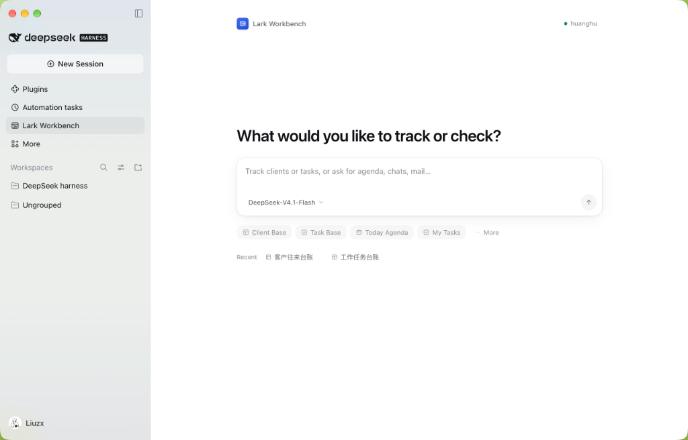

# dsh-lark-studio

[English](README_EN.md) | [简体中文](README.md)

[](https://www.npmjs.com/package/dsh-lark-studio)
[](https://www.npmjs.com/package/dsh-lark-studio)
[](https://www.npmjs.com/package/dsh-lark-studio)
[](https://dsh-plugin.org/plugins/deeplifestudio/dsh-lark-studio)
[](LICENSE)

A Feishu / Lark plugin for DeepSeek Harness. Built on top of the official [`lark-cli`](https://www.npmjs.com/package/@larksuite/cli), it lets you create and edit Lark Bitables in plain language and dynamically run 25+ official Feishu skills—covering calendar, tasks, chats, mail, contacts, approvals, docs, sheets, and meeting notes—directly from chat or the workbench.



## What it does

### 1. Build a Bitable from a single sentence

Describe what you want to track without worrying about column types upfront:

- *"Track customer leads with company, contact, budget, and deal stage"*
- *"Make a team expense reimbursement table"*
- *"Track engineering bugs and feature requests"*

The model drafts the schema (fields, select options, Kanban view, and sample rows). In the sidebar workbench, you can review the draft before creating the live Bitable in your personal Lark workspace.

You can also trigger it directly from the DSH chat composer:

```text
/lark Customer leads: company, contact, deal stage, next follow-up
```

### 2. Edit existing tables in conversation

Once a table is created, keep modifying its schema and rows through chat:

- *"Add a status column with options: Pending, In Review, Paid"*
- *"Rename priority options Low / Medium / High to P0 / P1 / P2"*
- *"Add a Kanban view grouped by status"*
- *"Add a record: Company Acme, Contact Alice, Budget $50,000"*
- *"Move the deadline of all in-progress tasks to next Friday"*

Destructive changes (deleting columns, views, options, or records) always pause and ask for confirmation before executing.

### 3. Daily Lark collaboration

Beyond Bitables, you can run everyday Lark workflows in chat:

- **Calendar**: check today's agenda, look up free/busy slots, create/update/cancel meetings
- **Tasks**: list open tasks, create tasks, assign owners, mark items complete
- **IM & Chats**: search group chats, read message history, send messages
- **Mail**: summarize inbox, read messages, send mail or save drafts
- **Contacts**: look up teammates by name, department, or employee ID
- **Approvals & Docs**: query pending approvals, approve/reject requests, read/write Docs and Wiki

When a required Lark Open Platform scope is missing, the plugin tells you which scope is needed and gives you a direct link to enable it.

<details>
<summary>Full feature list (Bitable + Lark collaboration CRUD)</summary>

#### Bitable

- **Tables**: create table (`add_table`), rename table (`rename_table`), inspect Base metadata and schema (`readSchema`)
- **Fields**:
  - Text: plain text, multiline, URL, phone, email, barcode
  - Numeric: integer/float, currency (CNY/USD/etc.), percentage, progress bar
  - Select: single select, multi select, with incremental option updates (`add_options` / `remove_options`)
  - Other: formatted date/time, user, checkbox, auto-number, formula, link/lookup
  - Schema edits: rename field (`rename_field`), delete field (`delete_field`)
- **Views**: Grid, Kanban, Gallery, Calendar, Gantt; create/rename/delete views and control per-view visible fields (`set_view_visible_fields`)
- **Records**: batch insert, conditional or ID-targeted update/delete, quick peek of the first 20 rows (`peek`)
- **Permissions & extensions**: toggle advanced permissions, create/update/delete custom roles (`create_role` / `update_role` / `delete_role`), field AI extensions, dashboards, forms

#### Lark collaboration (via `lark-cli`)

- **Calendar**
  - Create: schedule events/meetings (`calendar +create`), join events (`+join-event`)
  - Update: edit time/location/attendees (`calendar +update`), RSVP (`+rsvp`), transfer organizer (`+transfer`)
  - Delete: cancel/delete events (`calendar +delete`, including recurring events)
  - Read: agenda (`+agenda`), event details (`+get`), search (`+search-event`), free/busy (`+freebusy`), room finder (`+room-find`), attendees (`+list-attendees`), meeting notes (`+meeting`)
- **Tasks**
  - Create: tasks (`task +create`), task lists (`+tasklist-create`), subtasks (`subtasks create`), comments (`+comment`), attachments (`+upload-attachment`)
  - Update: complete (`+complete`), reopen (`+reopen`), assign (`+assign`), edit due date/details (`+update`), followers (`+followers`), reminders (`+reminder`)
  - Delete: delete tasks (`task tasks delete`), delete lists (`tasklists delete`), remove members (`members remove`)
  - Read: my tasks (`+get-my-tasks`), related tasks (`+get-related-tasks`), search tasks (`+search`), search lists (`+tasklist-search`)
- **IM & Chats**
  - Create / Send: text/Markdown/card messages (`im +messages-send`), thread replies (`+messages-reply`), create chats (`+chat-create`), flag (`+flag-create`), pin (`pins create`)
  - Update: edit sent messages (`+messages-edit`), update chat info (`+chat-update`), moderation settings (`chat.moderation update`)
  - Delete: recall/delete messages (`im messages delete`), unflag (`+flag-cancel`), unpin (`pins delete`)
  - Read: list chats (`+chat-list`), search chats (`+chat-search`), members (`+chat-members-list`), history (`+chat-messages-list`), global search (`+messages-search`), read receipts (`+message-read-users`), flagged list (`+flag-list`)
- **Mail**
  - Create: send mail (`mail +send`), create drafts (`+draft-create`), rules (`+rule-create`), templates (`+template-create`)
  - Update: reply / reply all (`+reply` / `+reply-all`), forward (`+forward`), edit/send drafts (`+draft-edit` / `+draft-send`), label/move/mark read (`+message-modify`), update/toggle rules (`+rule-update` / `+rule-enable` / `+rule-disable`)
  - Delete: move to trash (`+message-trash` / `+thread-trash`), delete rules (`+rule-delete`), discard drafts (`user_mailbox.drafts delete`)
  - Read: inbox triage (`+triage`), messages & attachments (`+message` / `+messages`), threads (`+thread`), folders (`user_mailbox.folders list`), rules (`+rule-list`), signatures (`+signature`)
- **Contacts**
  - Read: search users by name/ID/department (`contact +search-user`), get profile (`+get-user`), search bots (`+search-bot`), batch query profiles (`user_profiles batch_query`)
  - Enterprise ops: department creation, profile updates, and offboarding when using enterprise admin credentials
- **Approvals**
  - Initiate / Cancel: create approval instances (`approval instances create`), cancel own requests (`approval instances cancel`)
  - Actions: `approve`, `reject`, `transfer`, `add_sign`, `rollback`, `remind`
  - Read: pending tasks (`approval tasks query`), instance details (`approval instances get`), initiated requests (`approval instances initiated`), search definitions (`approval approvals search`)
- **Docs / Drive / Wiki / Markdown**
  - Create, read, and update doc blocks; upload, download, move, and delete Drive files; manage Wiki spaces/nodes and sharing permissions; create native Drive Markdown files
- **Scopes Inspector**
  - Checks granted scopes across Lark Open Platform domains and surfaces a direct console link with your App ID whenever an action lacks permission

</details>

## Lark Workbench

The plugin adds **Lark Workbench** to the DSH main sidebar, conversation view, and right sidebar:

- **Zero-install setup wizard**: automatically prepares `lark-cli` on first open (no manual Node.js or terminal install required; reuses `@deepseek-ai/dsh-feishu`'s CLI when present/newer), guides you through App linking and OAuth, and syncs with the account card on the DSH Plugins page.
- **Schema preview & draft recovery**: inspect fields, options, and sample rows before creating; unfinished drafts stay accessible under **Draft**, with Undo toasts if closed, discarded, or cleared by mistake.
- **File upload & multimodal reading**: click, drag-and-drop, or paste text, CSV/TSV/XLSX spreadsheets, DOCX/PPTX/PDF documents, and images to ask questions, design Bases, or batch-import real spreadsheet rows directly into Feishu Base.
- **End-to-end live streaming**: streams reasoning, table-building skeleton transitions, and Markdown replies in real time with smart auto-follow scrolling.
- **Split-pane view**: chat on the left, live embedded Lark Bitable on the right.
- **Full Chinese / English i18n**: UI copy, starter prompts, schema planning, and collaboration answers switch seamlessly with your DSH language setting.
- **Scope inspector & write guards**: surfaces missing scope names with direct developer-console links, and pauses for confirmation before destructive Base changes or mutating skill commands.

## Installation

### Prerequisites

- DeepSeek Harness `>= 0.2.2-rc.1 < 0.3.0-0`

> No pre-installed Node.js or global `lark-cli` is required: the plugin bundles and bootstraps `@larksuite/cli` automatically on first open.

### Install the plugin

Install from npm to your active profile (`web` or `desktop`):

```bash
# Web profile
dsh plugin --profile web add dsh-lark-studio

# Desktop profile
dsh plugin --profile desktop add dsh-lark-studio
```

You can also search for `dsh-lark-studio` in `dsh-market` inside DSH.

When running the Web UI, pass `--patch` so the sidebar workbench loads:

```bash
dsh start --patch
```

### Supported registries & directories

| Platform / Registry | Type | How to install or browse |
| :--- | :--- | :--- |
| [npm Registry](https://www.npmjs.com/package/dsh-lark-studio) | Primary registry | Run `dsh plugin add dsh-lark-studio`; supports version checks and `dsh plugin update` |
| [dsh-market](https://github.com/dsh-market/dsh-market) | In-app visual store | Search `dsh-lark-studio` or `Lark` under Settings → Plugin Market in DSH for one-click install/update |
| [Awesome DSH Plugin](https://awesome-dsh-plugin.com/p/DeepLifeStudio/dsh-lark-studio/) | Curated directory | Listed under productivity/collaboration ([GitHub repo](https://github.com/awesome-dsh-plugin/awesome-dsh-plugin)); upstream index for `dsh-market` |
| [DeepSeek 1024](https://deepseek1024.com/plugins/DeepLifeStudio/dsh-lark-studio) | Community store | Browse on the web or install via the `dsh-1024store` CLI |
| [DSH Plugin Hub](https://dsh-plugin.org/plugins/deeplifestudio/dsh-lark-studio) | Aggregated catalog | Automatically tracks npm and GitHub releases |
| [Official Discussions](https://github.com/deepseek-ai/deepseek-harness/discussions/14154) | Official showcase | Listed in DeepSeek Harness "Show Your Plugins!" for release notes and feedback |

### Update

```bash
dsh plugin --profile web update dsh-lark-studio
# Or update all installed plugins
dsh plugin update
```

> Prefer installing via npm rather than `git clone` or a GitHub URL, so `dsh plugin update` can detect and install new releases.

### First-time setup

Open **Lark Workbench** from the DSH left sidebar or right sidebar and follow three steps:

1. **Auto-prepare component**: automatically detects or installs `lark-cli` (preferring an official `@deepseek-ai/dsh-feishu` CLI if newer/available); you can also connect from the DSH Plugins page account card;
2. **Connect your Lark app**: create an app with one click or enter an existing `App ID` and `App Secret`;
3. **Browser OAuth**: approve sign-in in the browser.

<details>
<summary>Manual CLI installation for restricted networks (optional)</summary>

If automatic download is blocked in an offline or restricted environment, install globally and recheck:

```bash
npm install -g @larksuite/cli
```

</details>

### Configuration (optional)

Optional plugin settings available in DSH Plugins / Settings:

| Option | Default | Description |
| :--- | :--- | :--- |
| `larkCliPath` | Empty (auto) | Custom `lark-cli` executable path (or set `LARK_CLI_PATH`) |
| `binDir` | Empty | Custom directory containing `lark-cli` (compatible with `@deepseek-ai/dsh-feishu`) |
| `identity` | `auto` | Default Feishu API identity mode (`auto` / `user` / `bot`) |
| `showInConversationTab` | `false` | Show the Lark Workbench tab in the conversation header (off by default; toggleable in plugin settings) |

## Agent tools & commands

If you prefer working from the main DSH chat, the plugin registers structured tools, the `/lark` command, system prompt guidance, and a unified `feishu` skill provider (yielding automatically when `@deepseek-ai/dsh-feishu` is installed):

| Entry | Kind | Purpose |
| :--- | :--- | :--- |
| `/lark <description>` | Slash command | Create a Bitable from a short prompt |
| `lark_base_build` | Agent tool | Plan and build a Bitable (supports `preview: true`) |
| `lark_base_adjust` | Agent tool | Modify columns, options, views, and records on an existing Base |
| `lark_collab` | Agent tool | Run calendar, task, chat, mail, contact, and approval actions |

## FAQ

**Do I need to install Node.js or `lark-cli` manually?**  
No. The plugin manages and auto-prepares `lark-cli` for you (and reuses `@deepseek-ai/dsh-feishu`'s CLI when newer). The plugin never stores your Feishu password; all API calls use your own OAuth session and system keychain credentials.

**Where are created Bitables stored?**  
In your own Lark account under **My Space** (private by default). Use the share button in Lark whenever you want to invite teammates.

**Will casual chat accidentally create tables?**  
No. Normal greetings and questions stay in conversation; table planning only runs when you ask to build a table or use `/lark`.

## License

[MIT](LICENSE)
