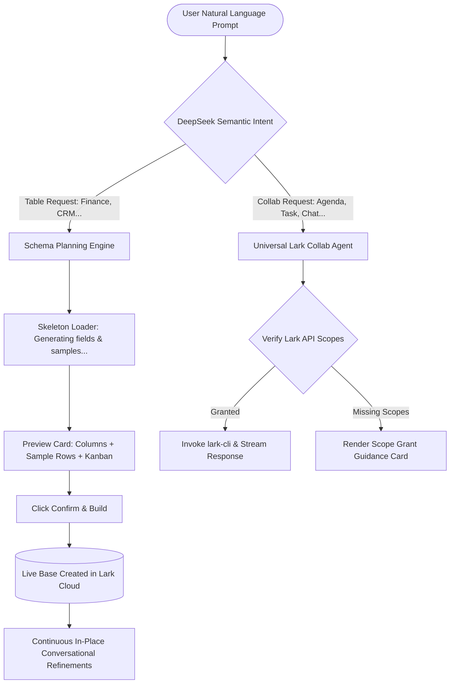

# Lark Universal AI Workbench (`dsh-lark-studio`)

[English](README_EN.md) | [简体中文](README.md)

> **One sentence to design a Bitable; one sentence to orchestrate Lark across your entire workspace.**  
> An LLM-Native universal collaboration and Bitable intelligence workbench plugin built for the [DeepSeek Harness](https://github.com/deepseek-ai) ecosystem.

[](https://www.npmjs.com/package/dsh-lark-studio)
[](https://dsh-plugin.org/plugins/deeplifestudio/dsh-lark-studio)
[](https://dsh-plugin.org/plugins/DeepLifeStudio/dsh-lark-studio)
[](https://dshopen.org)
[](LICENSE)

---

## Table of Contents
- [1. What is this?](#1-what-is-this)
- [2. What can it be used for?](#2-what-can-it-be-used-for)
  - [2.1 Zero-Shot Natural Language to Bitable Base](#21-zero-shot-natural-language-to-bitable-base)
  - [2.2 In-Place Continuous Conversational Refinement (Chat-to-Table Ops)](#22-in-place-continuous-conversational-refinement-chat-to-table-ops)
  - [2.3 Universal Lark Collaboration Agent](#23-universal-lark-collaboration-agent)
- [3. Why a Dedicated UI Workbench?](#3-why-a-dedicated-ui-workbench)
- [4. Complete Lark Feature Matrix (Full CRUD Spectrum)](#4-complete-lark-feature-matrix-full-crud-spectrum)
  - [4.1 Bitable Base Schema & Architecture](#41-bitable-base-schema--architecture)
  - [4.2 Views & Multidimensional Presentations](#42-views--multidimensional-presentations)
  - [4.3 Record-Level Data Operations](#43-record-level-data-operations)
  - [4.4 Enterprise Extensions & Advanced Permissions](#44-enterprise-extensions--advanced-permissions)
  - [4.5 Universal Collaboration (Full CRUD Matrix)](#45-universal-collaboration-full-crud-matrix)
- [5. Core Architecture & Interaction Flow](#5-core-architecture--interaction-flow)
- [6. Quick Start & Installation](#6-quick-start--installation)
  - [6.1 Prerequisites](#61-prerequisites)
  - [6.2 Ecosystem Indexes & Major Plugin Marketplaces](#62-ecosystem-indexes--major-plugin-marketplaces)
  - [6.3 Recommended Installation (via npm / Visual Store)](#63-recommended-installation-via-npm--visual-store)
  - [6.4 How to Update & Upgrade](#64-how-to-update--upgrade)
  - [6.5 Three-Step Onboarding Wizard (ConnectGate)](#65-three-step-onboarding-wizard-connectgate)
- [7. Frequently Asked Questions (FAQ)](#7-frequently-asked-questions-faq)
- [8. License](#8-license)

---

## 1. What is this?

**Lark Universal AI Workbench (`dsh-lark-studio`)** is an agentic desktop extension plugin deeply integrated into the DeepSeek Harness client.

Powered by the **DeepSeek reasoning engine**, it seamlessly bridges the official Lark CLI tool **`lark-cli` (`@larksuite/cli`)** with Lark Open Platform APIs. By leveraging end-to-end natural language understanding, it strips away technical jargon, database schemas, and complex API calls. Users simply describe what they need in plain language to orchestrate **Bitable Base schema architecture, field configuration, record maintenance**, as well as **calendar scheduling, task management, group chat messaging, email triage, and organizational directory queries**.

---

## 2. What can it be used for?

### 2.1 Zero-Shot Natural Language to Bitable Base
* **Plain Language to Production Schemas**: Say *"I want to track customer leads"*, *"Build a team expense reimbursement ledger"*, or *"R&D bug and requirement backlog"*. The model automatically reasons over business logic, generating a complete Base blueprint with 5–10 standardized business fields, single-select stage tags, Kanban grouping, and high-fidelity enterprise sample records.
* **Standardized Business Nomenclature**: No more ad-hoc column names. The AI normalizes colloquial terms into industry standards (e.g., "how much" $\rightarrow$ "Estimated Amount", "where are we" $\rightarrow$ "Sales Stage", "who's responsible" $\rightarrow$ User personnel field).
* **Instant Cloud Deployment**: Click **「Confirm & Build」** to automatically create the live Bitable in your personal Lark cloud space, generating a shareable collaboration link in seconds.

### 2.2 In-Place Continuous Conversational Refinement (Chat-to-Table Ops)
* **Dynamic Schema Evolution**: Refine structures directly via conversation without manual configuration in Feishu/Lark:
  * *"Add a reimbursement status column with options: Pending, In Review, Paid"*
  * *"Change the priority options Low, Medium, High to P0, P1, P2"*
  * *"Delete the Last Contact column"*
  * *"Create a new Kanban view grouped by Priority"*
* **Intelligent Data Ops & Batch Processing**:
  * *"Add a new customer record: Company ByteDance, Contact John Doe, Budget \$50,000"*
  * *"Postpone the deadline of all in-progress tasks to next Friday"*
  * *"Clear all voided invoice records"*

### 2.3 Universal Lark Collaboration Agent
Beyond tables, it acts as an intelligent executive assistant for daily workplace operations:
* **Calendar & Meetings**: *"What's on my schedule today?"*, *"Do I have free time tomorrow afternoon?"* — automatically extracts events, times, and meeting notes.
* **Tasks & TODOs**: *"List all my unfinished tasks"*, *"Mark 'Draft Project Proposal' as completed"*.
* **Instant Messaging**: *"Find active project group chats"*, *"Send a release update notification to the R&D group"*.
* **Mail Triage**: *"Check my unread emails and provide a brief summary"*.
* **Enterprise Directory**: *"Find Alice in Marketing: employee ID, email, and department"*.

---

## 3. Why a Dedicated UI Workbench?

Pure terminal CLIs or text-only chatbots suffer from inherent bottlenecks when handling structured business workflows. The UI Workbench bridges this gap:

| Dimension | Plain Text / Terminal CLI | Lark AI Workbench (UI) | Core Value & Significance |
| :--- | :--- | :--- | :--- |
| **Perception** | Black-box output; gives raw JSON or "Done" with no visibility into field types | **Dynamic Skeleton Loading $\rightarrow$ Structured Card Preview** | **WYSIWYG (What You See Is What You Get)**: Review column types, option pills, Kanban grouping, and sample rows before committing to cloud. |
| **Onboarding** | Requires manual CLI installs, OAuth App creation, terminal codes, and QR scans | **Built-in 3-Step Wizard (ConnectGate)** | **Zero-Friction Setup**: Auto-detects `lark-cli`, provides one-click copy commands, and guides app binding and device login visually. |
| **Dual-Screen Workflow**| Chat and browser tabs are separated; users constantly switch back and forth | **Split-Screen Dual-Pane Mode** | **Live Embedded Base**: AI chat console docked on the left; native Feishu Bitable webview on the right for real-time live synchronization. |
| **Transparency**| Rigid waiting states with blank screens; opaque model reasoning | **Live Thinking Stream** | **Explainable AI Agent**: DeepSeek's chain of thought is streamed live, showing how business requirements map to field types. |
| **Safety** | Destructive typos can permanently delete live production data | **Destructive Operation Interceptor** | **Guaranteed Data Safety**: Intercepts column removals, table drops, and batch record purges with explicit confirmation dialogues. |

---

## 4. Complete Lark Feature Matrix (Full CRUD Spectrum)

The workbench provides full coverage across Lark Open Platform capabilities:

### 4.1 Bitable Base Schema & Architecture
- [x] **Smart Blueprint Designer**: Turns natural language into validated Schemas (tables, field types, Kanban groups, sample rows).
- [x] **Multi-Table Management**:
  - Create table (`add_table`)
  - Rename table (`rename_table`)
  - Inspect Base metadata & table lists (`readSchema`)
- [x] **Field Lifecycle Management**:
  - **Textual**: Text, multiline, hyperlink (URL), phone, email, barcode
  - **Numeric**: Integer, high-precision float, currency (CNY/USD/EUR), percentage, colored progress bars
  - **Select**: Single-select dropdown, multi-select tags
  - **Option Pool**: Incrementally append options (`add_options`), safe prune options (`remove_options`)
  - **Date & Time**: Custom date/time formatting (`yyyy-MM-dd`, `HH:mm`)
  - **Personnel**: Lark corporate user fields (User)
  - **Logic**: Checkbox boolean fields
  - **Advanced & Computed**: Auto-number, formula calculations, two-way relations (Link / Lookup)
  - **Modifications**: Column rename (`rename_field`), safe column drop (`delete_field`)

### 4.2 Views & Multidimensional Presentations
- [x] **Grid View**: Classic spreadsheet overview and raw data entry.
- [x] **Kanban View**: Swimlane cards grouped by single-select fields (Status, Stage, Priority).
- [x] **Gallery View**: Rich media asset, product card, and profile views.
- [x] **Calendar View**: Date-driven agenda scheduling.
- [x] **Gantt View**: Project duration and task dependency timeline.
- [x] **View Operations**: Create view (`add_view`), rename view (`rename_view`), delete view (`delete_view`).
- [x] **View Masking**: Configurable visible/hidden column subsets per view (`set_view_visible_fields`).

### 4.3 Record-Level Data Operations
- [x] **Batch Add Records**: Auto-validates and formats text, selections, and numbers to insert multiple rows.
- [x] **Conditional & Exact Update**: Supports multi-criteria filter updates (`status === "Done"`) or specific Record ID mutations.
- [x] **Batch & Target Delete**: Deletes records by criteria filter or by physical Record IDs.
- [x] **Live Data Peek (Sampling)**: Inspects live table records (first 20 rows) without opening a heavy browser tab.

### 4.4 Enterprise Extensions & Advanced Permissions
- [x] **Advanced Permissions**: One-click toggle for table-level and field-level permission isolation.
- [x] **Role-Based Access Control (RBAC)**:
  - Create roles (`create_role`, defining table & field read/write grants)
  - Update role permissions (`update_role`)
  - Delete roles (`delete_role`)
- [x] **Field AI Extensions**: Binds native Lark AI models to specific fields for automatic batch inferences.
- [x] **Analytics Dashboards**: Generates statistical charts, metrics, and KPI summaries.
- [x] **Data Collection Forms**: Transforms tables into external survey/collection questionnaires.

### 4.5 Universal Collaboration (Full CRUD Matrix)

Aligned with the official `lark-cli` ecosystem, the workbench covers the complete **Create, Read, Update, Delete** lifecycle across all workplace domains:

<details>
<summary><b>👉 Click to expand full CRUD Collaboration Matrix (Calendar, Tasks, IM, Mail, Contacts, Approvals, Docs & Scopes Inspector)</b></summary>
<br>

#### 📅 Calendar & Meetings
* **Create**: Schedule events and meetings (`calendar +create`, specifying subject, time slots, and attendees), join events (`+join-event`).
* **Delete**: Delete or cancel calendar events (`calendar +delete`, supports recurring events and exceptions).
* **Update**: Modify event time, location, and attendee list (`calendar +update`), RSVP to invitations (`+rsvp` accept/decline/tentative), transfer organizer role (`+transfer`).
* **Read**: Today's/specific date agenda (`calendar +agenda`), event details (`+get`), search events (`+search-event`), multi-user free/busy check (`+freebusy`), meeting room finder (`+room-find`), attendee status (`+list-attendees`), meeting notes (`+meeting`).

#### 📋 Tasks & TODOs
* **Create**: Create tasks (`task +create`), create task lists (`+tasklist-create`), split subtasks (`subtasks create`), add comments (`+comment`), upload attachments (`+upload-attachment`).
* **Delete**: Delete tasks (`task tasks delete`), delete task lists (`tasklists delete`), remove members (`members remove`).
* **Update**: Mark tasks as complete (`task +complete`), reopen tasks (`+reopen`), assign/transfer owners (`+assign`), update due dates and descriptions (`+update`), manage followers (`+followers`), set reminders (`+reminder`).
* **Read**: My tasks list (`task +get-my-tasks`), related tasks (`+get-related-tasks`), keyword task search (`+search`), search task lists (`+tasklist-search`).

#### 💬 Instant Messaging & Chats (IM)
* **Create / Send**: Send text, Markdown, and interactive card messages (`im +messages-send`, P2P and groups), reply in thread (`+messages-reply`), create group chats (`+chat-create`), flag messages (`+flag-create`), pin messages (`pins create`).
* **Delete / Recall**: Recall/delete sent messages (`messages delete`), remove flags (`+flag-cancel`), unpin messages (`pins delete`).
* **Update**: Edit sent messages (`im +messages-edit`), update group name and description (`+chat-update`), manage moderation settings (`chat.moderation update`).
* **Read**: List chats (`im +chat-list`), search chats (`+chat-search`), list chat members (`+chat-members-list`), fetch chat history (`+chat-messages-list`), global message search (`+messages-search`), read receipts tracking (`+message-read-users`), list flagged messages (`+flag-list`).

#### ✉️ Lark Mail
* **Create / Compose**: Compose and send emails (`mail +send`), create drafts (`+draft-create`), create mailbox rules (`+rule-create`), create email templates (`+template-create`).
* **Delete / Trash**: Soft-delete emails to trash (`mail +message-trash`), delete threads (`+thread-trash`), delete mailbox rules (`+rule-delete`), discard drafts (`user_mailbox.drafts delete`).
* **Update / Reply**: Reply / Reply all (`mail +reply` / `+reply-all`), forward emails (`+forward`), edit drafts (`+draft-edit`), send existing drafts (`+draft-send`), label/move messages (`+message-modify`), update rules (`+rule-update`), enable/disable rules (`+rule-enable`/`disable`).
* **Read**: Inbox triage summary (`mail +triage`), read full message body and attachments (`+message` / `+messages`), read complete conversation threads (`+thread`), list folders (`user_mailbox.folders list`), list rules (`+rule-list`), inspect signatures (`+signature`).

#### 👤 Contacts & Organization
* **Read**: Search users (`contact +search-user`, lookup by name, employee ID, or department), get user profile (`+get-user`), search workplace bots & agents (`+search-bot`), batch query user profiles (`user_profiles batch_query`).
* **Enterprise Ops**: Supports department creation, member profile updates, and offboarding with enterprise admin credentials.

#### 🛡️ Approvals & Workflows
* **Create**: Initiate leave, reimbursement, seal, and purchase approvals (`approval instances create`).
* **Cancel**: Cancel pending approvals initiated by current user (`approval instances cancel`).
* **Update / Action**: Approve tasks (`approval tasks approve`), reject tasks (`approval tasks reject`), transfer tasks (`approval tasks transfer`), add signers (`approval tasks add_sign`), rollback tasks (`approval tasks rollback`), send reminders (`approval tasks remind`).
* **Read**: Query pending approval tasks (`approval tasks query`), inspect approval instance details and form data (`approval instances get`), list initiated approvals (`approval instances initiated`), search approval definitions (`approval approvals search`).

#### 📄 Docs & Cloud Drive (Docs / Drive / Wiki / Markdown)
* **Create**: Create cloud docs (`docs`), upload files to Drive (`drive`), create Wiki spaces and nodes (`wiki`), create native Drive Markdown files (`markdown`).
* **Delete**: Delete Drive files, remove Wiki nodes.
* **Update**: Append or update document content blocks, move files and Wiki nodes, update sharing and collaborator permissions.
* **Read**: Read document structure and full text, download files, export Wiki navigation trees.

#### 🔒 Scopes Inspector
* **Full Diagnostic**: Automatically inspects granted permissions across 22 Open Platform domains.
* **Graceful Degradation**: When invoking an ungranted capability, intercepts errors and displays a card with direct links to the Lark developer console for one-click authorization.

</details>

---

## 5. Core Architecture & Interaction Flow

The workbench follows an **LLM-Native Agent** architecture, eliminating rigid keyword regexes:



---

## 6. Quick Start & Installation

### 6.1 Prerequisites
1. **Node.js**: Version `>= 18.0.0`
2. **Lark CLI Tool (`lark-cli`)**:
   ```bash
   npm install -g @larksuite/cli
   ```

### 6.2 Ecosystem Indexes & Major Plugin Marketplaces

As a premier application in the DeepSeek Harness ecosystem, this plugin is indexed, published, and discoverable across major official and community registries and marketplaces:

| Platform / Registry | Channel Type | Access & Discovery |
| :--- | :--- | :--- |
| 📦 **[npm Registry](https://www.npmjs.com/package/dsh-lark-studio)** | Official Primary Package Registry | Standard npm distribution supporting native `dsh plugin add`, automated version detection, and clean updates |
| 🛒 **[dsh-market](https://github.com/dsh-market/dsh-market)** | Built-in Visual Store (#1 by downloads) | Install `dshmarket` in your DSH client, then search `dsh-lark-studio` / `Lark` in Settings → Plugin Market for one-click installation and updates |
| 🏪 **[DeepSeek 1024 Plugin Store](https://deepseek1024.com)** | Automated Enterprise Store | Automated static format validation; browse via `deepseek1024.com` or install via CLI (`dsh-1024store`) |
| 🌟 **[Awesome DSH Plugin](https://github.com/awesome-dsh-plugin/awesome-dsh-plugin)** | Curated Benchmark Directory | Featured under productivity and collaboration tools, serving as the foundational index for visual marketplaces |
| 🌐 **[DSH Plugin Hub](https://dsh-plugin.org/plugins/DeepLifeStudio/dsh-lark-studio)** | Largest Aggregated Directory | [Direct Plugin Page](https://dsh-plugin.org/plugins/DeepLifeStudio/dsh-lark-studio), automatically synced daily with npm and GitHub releases |
| 🔎 **[DSHSeek](https://dshseek.com/zh/plugins/)** | Verified Community Catalog | Human-verified directory ensuring link reachability and integration stability |
| 📚 **[Awesome DeepSeek Harness](https://github.com/libukai/awesome-deepseek-harness)** | Comprehensive Guide & Toolkit | Community-curated guidebook listing top plugins and starter resources |
| 💬 **[Official Discussions](https://github.com/deepseek-ai/deepseek-harness/discussions/14154)** | DeepSeek Native Community | Formally listed under the official "Show Your Plugins!" showcase section |
| 🚀 **[dshopen Plugin Index](https://dshopen.org)** | Open Ecosystem Portal | Curated indexing portal providing configuration guides and setup documentation |

### 6.3 Recommended Installation (via npm / Visual Store)

We strongly recommend installing via npm to your active DSH profile (such as `web` or `desktop`):
```bash
# Recommended: Install to active profile
dsh plugin --profile web add dsh-lark-studio

# For desktop profile:
dsh plugin --profile desktop add dsh-lark-studio
```

Alternatively, open the built-in **`dsh-market`** visual store inside DeepSeek Harness and click **「Install」**.

> **Startup Notice**: When using the Web UI, always launch DSH with the `--patch` parameter so that the sidebar workbench loads properly:
> ```bash
> dsh start --patch
> ```

---

### 6.4 How to Update & Upgrade

#### Method 1: One-Click CLI Upgrade (Recommended)
```bash
# Upgrade this plugin to latest version
dsh plugin --profile web update dsh-lark-studio

# Or check and upgrade all installed plugins
dsh plugin update
```

#### Method 2: Graphical One-Click Update
If installed through visual stores like `dsh-market` or `1024store`, a red update indicator will appear under DSH **Settings → Plugin Market** whenever a new release is available. Click **「Update」** for seamless in-place upgrade.

---

> [!WARNING]
> ### ⚠️ Why Git Source Installation (`git clone`) is Strongly Discouraged
> 
> While some developers may be accustomed to using `git clone` or `github:owner/repo`, we **strongly advise against** this in production:
> 1. **No Version Update Alerts**: Cloning Git branches bypasses SemVer metadata; DSH cannot detect upstream releases, leaving your installation permanently outdated;
> 2. **Incompatible with `dsh plugin update`**: Plugins installed via Git are treated as external local directories and skipped during `dsh plugin update`. Users must manually `cd`, `git pull`, and rebuild dependencies, which often introduces version skew and runtime errors;
> 3. **Lacks Automated Integrity Verification**: npm distribution includes automated security reviews and SHA-512 integrity hashes, preventing corrupt or truncated files caused by transient network failures.
> 
> **Always prefer `dsh plugin add dsh-lark-studio` (npm package) for installation and maintenance!**

### 6.5 Three-Step Onboarding Wizard (ConnectGate)
When opening the workbench for the first time, it automatically verifies your environment:
1. **Tool Check (CLI)**: Verifies whether `lark-cli` is installed. If missing, provides a one-click copy command.
2. **App Configuration (App)**: One-click jump to the Lark Developer Console to auto-initialize an app, or manually enter your enterprise `App ID` and `App Secret`.
3. **Identity Authorization (Auth)**: Click "Authorize", confirm login in your browser via Device Flow, and you are ready to go.

---

## 7. Frequently Asked Questions (FAQ)

#### Q1: Do other team members also need to install `lark-cli`?
**Yes.** `lark-cli` is the official client used to communicate securely with Lark OpenAPI without hardcoding credentials. The workbench provides an automated visual wizard to guide any new user through setup in under a minute.

#### Q2: Where are the generated Bitables stored?
By default, they are stored in the authorized user's private cloud workspace (**"My Space"**). Only you have access until you choose to share the generated link with teammates.

#### Q3: Will greetings or casual chat accidentally trigger table creation?
**No.** DeepSeek's native intent classification handles general greetings ("Hello", "Thank you") and queries naturally in conversational mode without fabricating unwanted tables.

---

## 8. License

This project is licensed under the [MIT License](LICENSE). Contributions, issues, and pull requests are welcome!
